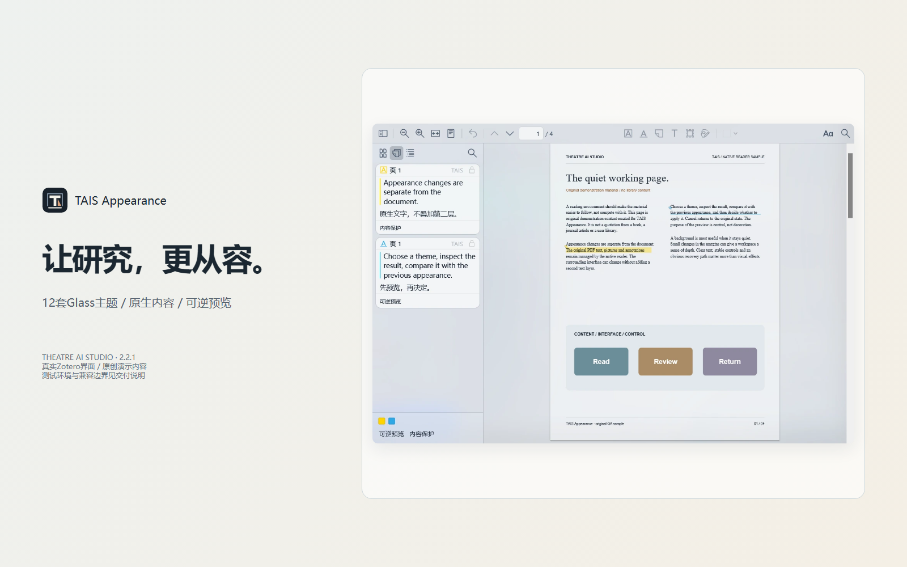
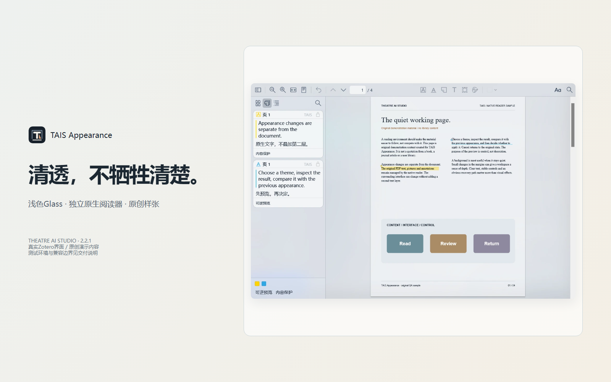
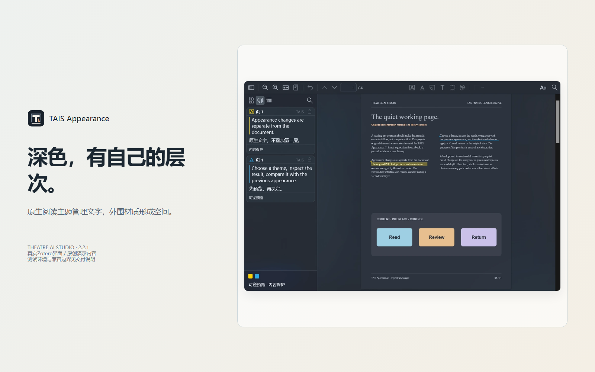
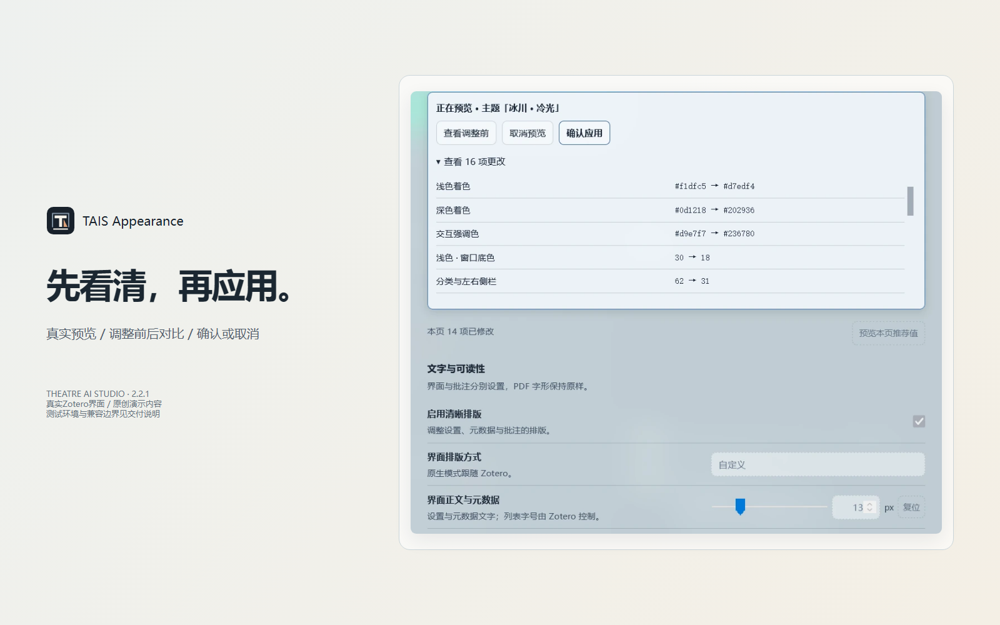
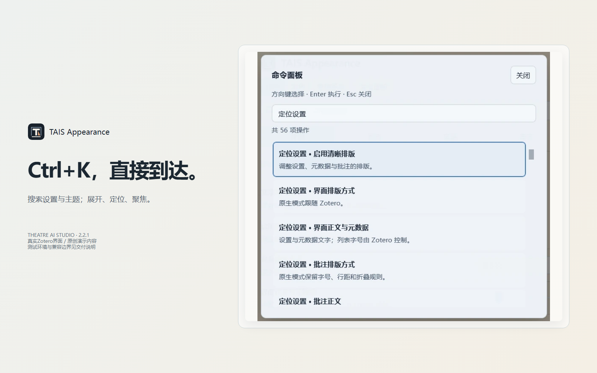
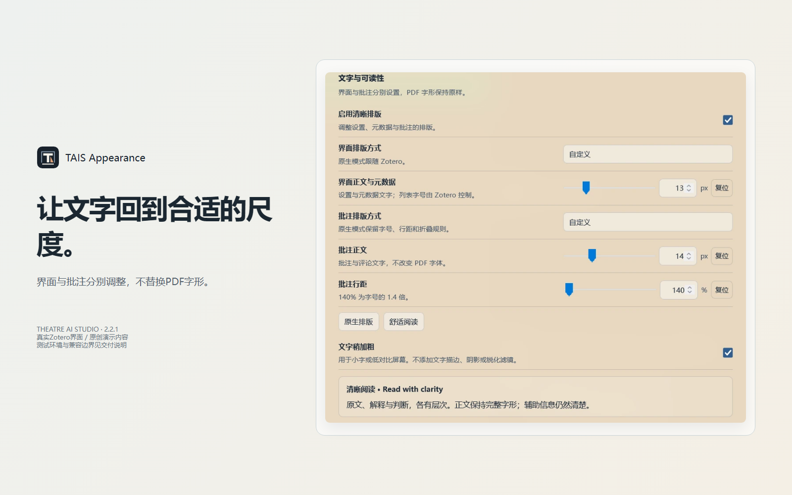
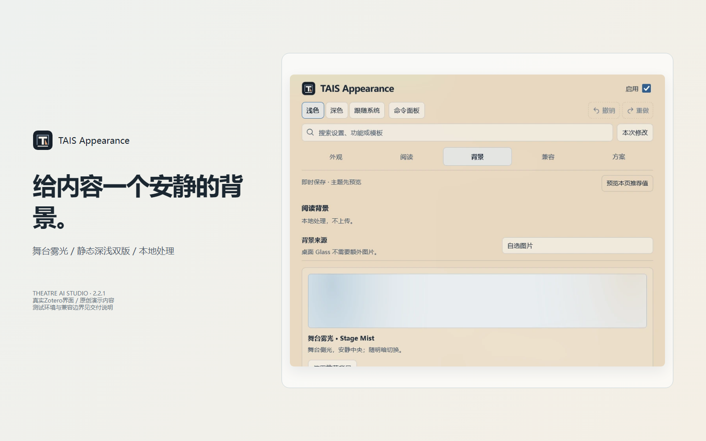
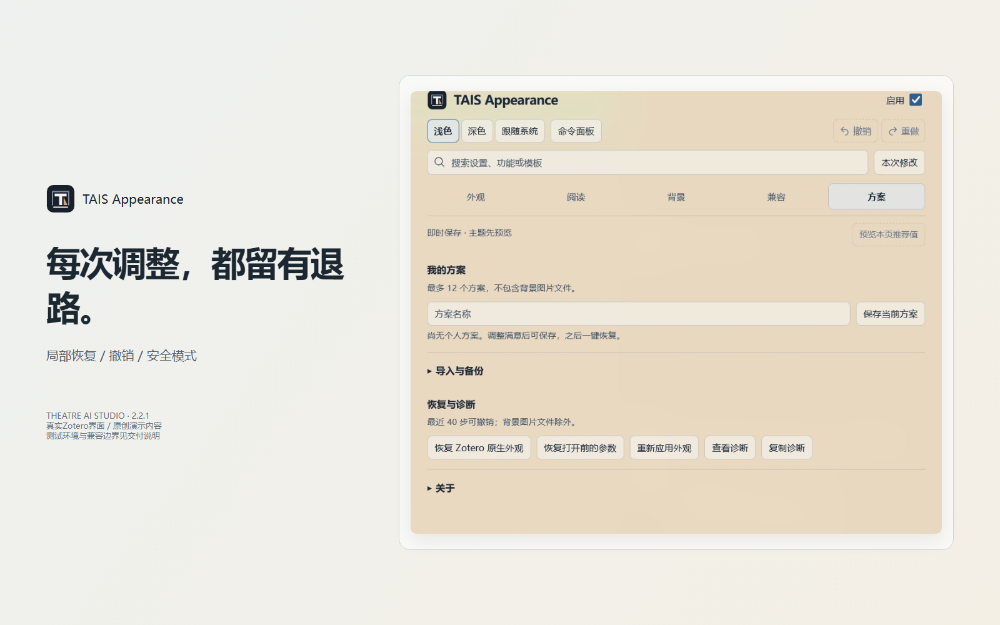

# TAIS Appearance

**Make Zotero feel like a calm, coherent reading workspace.**  
A Glass appearance system by **Theatre AI Studio (TAIS)** — designed for long reading sessions, focused research, and clear annotation work.

[**Open the interactive product tour →**](https://lipo1024.github.io/tais-appearance/) · [Source code](https://github.com/LIPO1024/tais-appearance) · [Report an issue](https://github.com/LIPO1024/tais-appearance/issues)



## See what changes

TAIS Appearance gives Zotero one consistent visual language: translucent interface surfaces, carefully tuned light and dark modes, readable annotation typography, and a quieter reading surround. **PDF text, embedded fonts, native selection, and annotations remain under Zotero/PDF.js control.**

| Light appearance | Dark appearance |
|---|---|
|  |  |
| **Reversible theme preview** | **Command palette** |
|  |  |
| **Typography controls** | **Local reading backgrounds** |
|  |  |
| **Profiles and presets** | **Recovery and diagnostics** |
|  |  |

*Product visuals are illustrative feature previews. See the live product tour for interactive demonstrations and the compatibility notes below for the tested environment.*

## Why use it?

- **12 Glass presets** — six light and six dark appearances, organized into four visual families.
- **Readable by design** — independent controls for Zotero interface text and annotation cards; no PDF glyph blur or duplicate text layer.
- **A reading surface you can tune** — page surround and paper surface are separate, with contrast safeguards.
- **Preview before applying** — compare, apply, cancel, undo, and restore through reversible settings transactions.
- **Local backgrounds** — built-in Stage Mist and custom images are processed locally.
- **Profiles and recovery** — save appearance setups, import scoped settings, inspect conflicts, and restore native Zotero appearance.
- **Five interface languages** — Simplified Chinese, English, Japanese, Korean, and French, plus automatic language selection.

## Free, with optional $1 support

The complete core plugin is free and open source. **All 12 bundled themes and core appearance controls remain available to everyone.**

If TAIS Appearance improves your daily reading, you can optionally support ongoing maintenance with a **one-time US$1 contribution**. Support is voluntary; it does not unlock themes or restrict AGPL rights. Supporter recognition and project updates may be offered where the funding platform supports them.

A separate optional TAIS visual asset pack may be offered in the future under its own clearly stated license. It will not gate any AGPL-covered plugin feature.

[Read the funding and licensing plan](docs/MONETIZATION.md) · [Payment setup notes (中文)](docs/PAYMENT-SETUP.zh-CN.md)

> **Funding status:** GitHub Sponsors onboarding and payment settlement are not yet confirmed. No payment credentials are collected by the plugin.

## Find TAIS in the Zotero community market

A submission has been opened with the community-maintained [Zotero Add-ons Scraper](https://github.com/syt2/zotero-addons-scraper) used by the [Add-on Market for Zotero](https://github.com/syt2/zotero-addons). **Maintainer review is pending**; the plugin is not yet listed in that market.

[Track the marketplace submission](https://github.com/syt2/zotero-addons-scraper/pull/315)

Zotero’s own documentation currently says it does not provide a plugin directory; the community market is a separate project.

## Product tour

[**Explore the interactive multilingual showcase →**](https://lipo1024.github.io/tais-appearance/)

The product tour demonstrates light/dark appearances, all 12 theme palettes, reading-surface controls, and the main feature set. It runs without analytics or external image/font requests.

## Install

**Beta download is available:** [TAIS Appearance 2.3.1 Beta (.xpi)](https://github.com/LIPO1024/tais-appearance/releases/download/v2.3.1/TAIS_Appearance-2.3.1.xpi) · [Release notes and SHA-256](https://github.com/LIPO1024/tais-appearance/releases/tag/v2.3.1)

This is a beta build. Test it in a separate Zotero profile first and export your settings before upgrading a primary profile.

1. Download the XPI asset from the release link above.
2. In Zotero, open **Tools → Plugins**.
3. Open the gear menu and choose **Install Plugin From File**.
4. Select the downloaded XPI.

The validated target is Windows 11 / Zotero 10.0.8 / PDF.js 5.7.0. macOS and Linux are not supported by the current Windows DWM material adapter. The five-language translations are machine-generated drafts and still require native-speaker review.

## Compatibility and safety

| Environment | Status |
|---|---|
| Windows 11 | Primary tested platform |
| Zotero 10.0.8 | Validated target |
| PDF.js 5.7.0 | Validated target |
| macOS / Linux | Not supported by the current Windows DWM material adapter |
| Other Zotero versions | Not yet verified |

TAIS Appearance processes custom backgrounds locally and does not need Zotero cloud credentials. It does not intentionally read or upload document contents. PDF rendering and document data remain under Zotero/PDF.js control. Plugins have broad access to Zotero and your computer; install only builds you trust.

## Documentation — five languages

| Language | User guide | README |
|---|---|---|
| 简体中文 | [使用手册](docs/USER_GUIDE.zh-CN.md) | [中文说明](README.zh-CN.md) |
| English | [User guide](docs/USER_GUIDE.en-US.md) | [README](README.en-US.md) |
| 日本語 | [ユーザーガイド](docs/USER_GUIDE.ja-JP.md) | [README](README.ja-JP.md) |
| 한국어 | [사용자 가이드](docs/USER_GUIDE.ko-KR.md) | [README](README.ko-KR.md) |
| Français | [Guide utilisateur](docs/USER_GUIDE.fr-FR.md) | [README](README.fr-FR.md) |

Translation coverage is complete as a draft; machine-generated additions still require native-speaker review. See [internationalization status](docs/I18N-STATUS.md).

## Build from source

Requirements are listed in `requirements-build.txt`.

```powershell
python -m pip install -r requirements-build.txt
python build.py
```

The build runs JavaScript, CSS, XML, and regression checks and produces an XPI. Public release builds require reviewed HTTPS update metadata and explicit license/release approval.

## License and third-party notices

This derivative is distributed under the applicable **AGPL** terms. It includes modified code derived from [Mica for Zotero](https://github.com/northword/zotero-mica). See [LICENSE](LICENSE), [NOTICE](NOTICE), and [third-party notices](docs/THIRD_PARTY_NOTICES.md). All bundled themes remain available under the applicable license; no theme paywall is implemented.

---

**Theatre AI Studio · TAIS Appearance**  
[Website](https://lipo1024.github.io/tais-appearance/) · [GitHub](https://github.com/LIPO1024/tais-appearance) · [Issues](https://github.com/LIPO1024/tais-appearance/issues) · [Funding information](docs/MONETIZATION.md)

