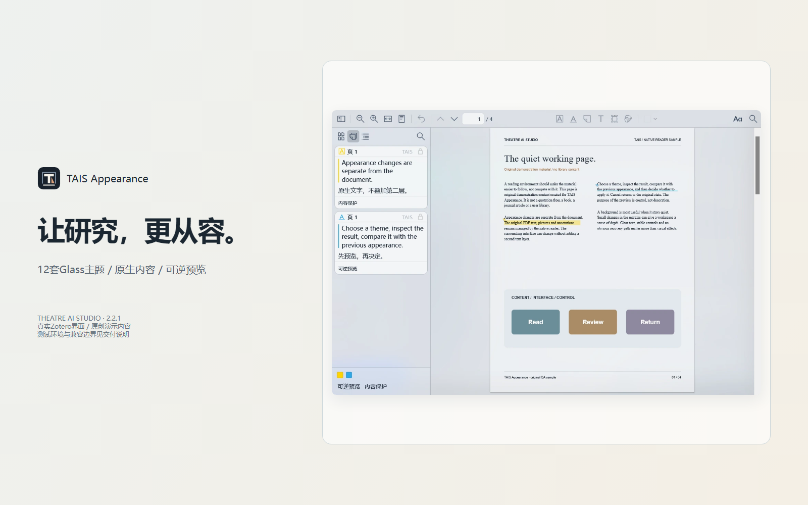

# TAIS Appearance

  

  <strong>Un environnement de lecture plus calme et cohérent dans Zotero.</strong> 
  Un système d’apparence Glass pour la lecture, la recherche et les annotations, développé par Theatre AI Studio.

  <a href="https://lipo1024.github.io/tais-appearance/"><strong>Voir la démo</strong></a> ·
  <a href="https://github.com/LIPO1024/tais-appearance/releases/latest"><strong>Télécharger gratuitement</strong></a> ·
  <a href="docs/USER_GUIDE.fr-FR.md"><strong>Lire le guide</strong></a>

## Présentation

TAIS Appearance apporte à Zotero un environnement visuel cohérent : surfaces translucides, modes clair et sombre, typographie lisible pour les annotations et environnement de lecture réglable. L’extension ne prend pas en charge le rendu du contenu PDF.

**Principe : l’interface peut changer, mais le document source doit rester lisible et fiable.** Le texte PDF, les polices intégrées, la sélection et les annotations restent gérés par Zotero/PDF.js.

## Fonctionnalités

- **12 thèmes Glass** : six thèmes clairs et six thèmes sombres.
- **Typographie indépendante** : réglages distincts pour l’interface Zotero et les cartes d’annotation.
- **Surfaces de lecture** : réglage séparé de l’arrière-plan périphérique et du papier, avec protection du contraste.
- **Aperçus réversibles** : comparer, prévisualiser, appliquer, annuler et restaurer.
- **Arrière-plans locaux** : Stage Mist et images personnalisées traités localement.
- **Profils et récupération** : enregistrer/importer/exporter les paramètres, vérifier les conflits et utiliser le mode sans échec.
- **Cinq langues** : chinois simplifié, anglais, japonais, coréen et français.

## Gratuit et open source

TAIS Appearance est un **projet gratuit et open source** dont les mainteneurs ne facturent pas les utilisateurs.

- Tous les thèmes et toutes les fonctions principales sont gratuits.
- Il n’existe aucune édition payante, adhésion, clé d’activation, restriction de thème ou de fonctionnalité.
- Aucun abonnement, frais de licence, don ou parrainage financier n’est demandé.
- Le plugin n’intègre ni SDK de paiement, ni publicité, ni suivi analytique, ni service d’activation commerciale.

Le projet comprend du code dérivé de Mica for Zotero et est distribué selon les conditions GNU AGPL applicables. Les mentions de droits et le code source correspondant doivent être conservés.

## Démo et guides en cinq langues

[Découvrir la présentation interactive](https://lipo1024.github.io/tais-appearance/)

- [简体中文 使用手册](docs/USER_GUIDE.zh-CN.md)
- [English User Guide](docs/USER_GUIDE.en-US.md)
- [日本語ユーザーガイド](docs/USER_GUIDE.ja-JP.md)
- [한국어 사용자 가이드](docs/USER_GUIDE.ko-KR.md)
- [Guide utilisateur français](docs/USER_GUIDE.fr-FR.md)

La couverture automatique des traductions est vérifiée, mais une relecture par des locuteurs natifs reste nécessaire. Voir [l’état de l’internationalisation](docs/I18N-STATUS.md).

[Matrice de compatibilité](docs/COMPATIBILITY.md) · [Architecture des adaptateurs](docs/PLATFORM-ADAPTER-ARCHITECTURE.md) · [Glossaire multilingue](docs/LOCALIZATION-GLOSSARY.md)

## Installation

[Télécharger TAIS Appearance 2.4.0 Stable (.xpi)](https://github.com/LIPO1024/tais-appearance/releases/download/v2.4.0/TAIS_Appearance-2.4.0.xpi)

Dans Zotero, ouvrez Outils → Extensions → menu engrenage → Installer depuis un fichier, puis sélectionnez le XPI. Cette version Stable est validée pour Windows 11 / Zotero 10.0.8 / PDF.js 5.7.0. Exportez vos paramètres avant de mettre à jour votre profil principal ; les autres plateformes et versions de Zotero non listées ne sont pas prises en charge ou vérifiées.

[Matrice de compatibilité et feuille de route](docs/COMPATIBILITY.md) · [Architecture des adaptateurs](docs/PLATFORM-ADAPTER-ARCHITECTURE.md)

## Compatibilité

| Environnement | État |
|---|---|
| Windows 11 | Plateforme principale testée |
| Zotero 10.0.8 | Cible validée |
| PDF.js 5.7.0 | Cible validée |
| macOS / Linux | Non pris en charge par l’adaptateur Windows DWM actuel |
| Autres versions de Zotero | Non vérifiées |

## Confidentialité et sécurité

Les images d’arrière-plan sont traitées localement. Le plugin ne lit ni ne téléverse intentionnellement le contenu des documents. Le rendu PDF, la sélection et les annotations restent gérés par Zotero/PDF.js. Avant de partager un diagnostic, masquez les chemins locaux et les informations personnelles.

## Participer au projet

- [Signaler un bug ou proposer une fonctionnalité](https://github.com/LIPO1024/tais-appearance/issues)
- [Guide de contribution](CONTRIBUTING.md)
- [Signaler une vulnérabilité](SECURITY.md)
- [Historique des modifications](CHANGELOG.md)

## Compiler depuis les sources

Installez les dépendances de `requirements-build.txt`, puis exécutez `python build.py`.

[Politique open source](docs/OPEN-SOURCE-POLICY.md) · [Guide de contribution](CONTRIBUTING.md)

## Licence

Distribué selon les conditions **GNU AGPL-3.0** applicables. Consultez [LICENSE](LICENSE), [NOTICE](NOTICE) et les [mentions tierces](docs/THIRD_PARTY_NOTICES.md).

[Site du produit](https://lipo1024.github.io/tais-appearance/) · [GitHub](https://github.com/LIPO1024/tais-appearance) · [Issues](https://github.com/LIPO1024/tais-appearance/issues)
