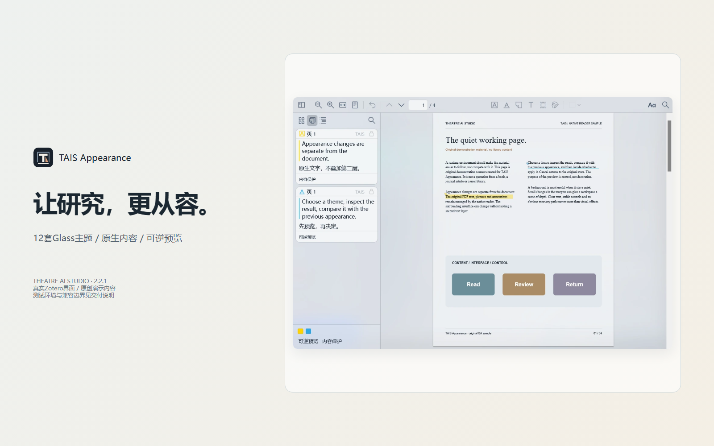

# TAIS Appearance

  

  <strong>Zotero で、より落ち着いた読書環境を。</strong> 
  Theatre AI Studio が開発する、読書・研究・注釈作業のための Glass 外観システムです。

  <a href="https://lipo1024.github.io/tais-appearance/"><strong>製品デモを見る</strong></a> ·
  <a href="https://github.com/LIPO1024/tais-appearance/releases/latest"><strong>無料ダウンロード</strong></a> ·
  <a href="docs/USER_GUIDE.ja-JP.md"><strong>ユーザーガイド</strong></a>

## 製品概要

TAIS Appearance は、半透明のインターフェース、ライト／ダーク表示、注釈の文字設定、読書ページ周辺の外観を統一します。PDF 本文の描画を置き換えるものではありません。

**基本方針：インターフェースは変えても、原文の可読性と信頼性は守ります。** PDF の文字、埋め込みフォント、選択、注釈は Zotero/PDF.js が管理します。

## 主な機能

- **12 種類の Glass テーマ**：ライト 6 種類、ダーク 6 種類。
- **独立した文字設定**：Zotero の UI と注釈カードを個別に調整。
- **読書面の調整**：ページ周辺と紙面を分けて設定し、コントラストを保護。
- **元に戻せるプレビュー**：比較、適用、キャンセル、取り消し、復元。
- **ローカル背景画像**：Stage Mist とカスタム画像をローカルで処理。
- **プロファイルと復元**：設定の保存・入出力、競合確認、セーフモード。
- **5 言語対応**：簡体字中国語、英語、日本語、韓国語、フランス語。

## 無料・オープンソース

TAIS Appearance は**無料のオープンソースプロジェクト**です。開発者は利用者に料金を請求しません。

- すべてのテーマとコア機能を無料で利用できます。
- 有料版、会員制、ライセンスキー、テーマ制限、機能制限はありません。
- サブスクリプション、ライセンス料、寄付、スポンサー支援の支払いは受け付けません。
- プラグインに決済 SDK、広告、アクセス解析、商用アクティベーション機能は含まれません。

本プロジェクトには Mica for Zotero に由来するコードが含まれ、適用される GNU AGPL の条件で配布されます。ライセンスと上流の著作権表示を保持してください。

## デモと 5 言語のガイド

[インタラクティブな製品デモ](https://lipo1024.github.io/tais-appearance/)

- [简体中文 使用手册](docs/USER_GUIDE.zh-CN.md)
- [English User Guide](docs/USER_GUIDE.en-US.md)
- [日本語ユーザーガイド](docs/USER_GUIDE.ja-JP.md)
- [한국어 사용자 가이드](docs/USER_GUIDE.ko-KR.md)
- [Guide utilisateur français](docs/USER_GUIDE.fr-FR.md)

翻訳は自動カバレッジ検査済みですが、ネイティブ話者による校閲は未完了です。詳しくは [国際化状況](docs/I18N-STATUS.md) を参照してください。

[互換性マトリクス](docs/COMPATIBILITY.md) · [プラットフォームアダプター設計](docs/PLATFORM-ADAPTER-ARCHITECTURE.md) · [多言語用語集](docs/LOCALIZATION-GLOSSARY.md)

## インストール

[TAIS Appearance 2.4.1 Stable（XPI）をダウンロード](https://github.com/LIPO1024/tais-appearance/releases/download/v2.4.1/TAIS_Appearance-2.4.1.xpi)

Zotero の「ツール → プラグイン → 歯車 → ファイルからプラグインをインストール」で XPI を選択します。Windows 11 / Zotero 10.0.8 / PDF.js 5.7.0 を検証対象とする Stable 版です。メインのプロファイルを更新する前に設定をエクスポートしてください。その他のプラットフォームや未記載の Zotero バージョンは未対応または未検証です。

[互換性マトリクスとプラットフォーム計画](docs/COMPATIBILITY.md) · [プラットフォームアダプター設計](docs/PLATFORM-ADAPTER-ARCHITECTURE.md)

## 対応環境

| 環境 | 状態 |
|---|---|
| Windows 11 | 主なテスト環境 |
| Zotero 10.0.8 | 検証済み |
| PDF.js 5.7.0 | 検証済み |
| macOS / Linux | 現在の Windows DWM アダプターでは非対応 |
| その他の Zotero バージョン | 未検証 |

## プライバシーと安全性

背景画像はローカルで処理されます。文献本文を意図的に読み取ったりアップロードしたりしません。PDF の描画、選択、注釈は Zotero/PDF.js が管理します。診断情報を共有する前に、ローカルパスや個人情報を削除してください。

## 開発への参加

- [Issue を作成](https://github.com/LIPO1024/tais-appearance/issues)
- [貢献ガイド](CONTRIBUTING.md)
- [セキュリティ報告](SECURITY.md)
- [変更履歴](CHANGELOG.md)

## ソースからビルド

`requirements-build.txt` の依存関係をインストールし、`python build.py` を実行します。

[プロジェクトのオープンソース方針](docs/OPEN-SOURCE-POLICY.md) · [開発への参加](CONTRIBUTING.md)

## ライセンス

適用される **GNU AGPL-3.0** の条件で配布されます。[LICENSE](LICENSE)、[NOTICE](NOTICE)、[第三者ライセンス表示](docs/THIRD_PARTY_NOTICES.md) を確認してください。

[製品サイト](https://lipo1024.github.io/tais-appearance/) · [GitHub](https://github.com/LIPO1024/tais-appearance) · [Issue](https://github.com/LIPO1024/tais-appearance/issues)
