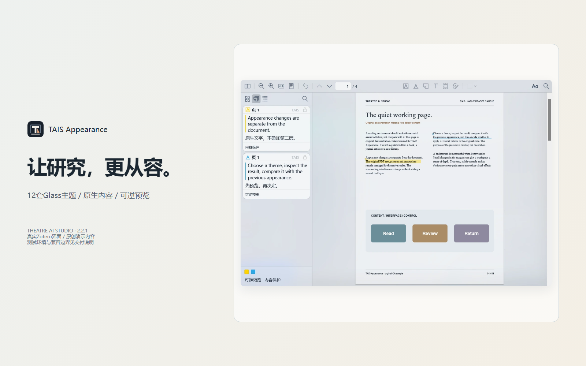

# TAIS Appearance

  

  <strong>Zotero에서 더 차분하고 일관된 읽기 환경을 만드세요.</strong> 
  Theatre AI Studio가 개발한 연구·독서·주석 작업용 Glass 외관 시스템입니다.

  <a href="https://lipo1024.github.io/tais-appearance/"><strong>제품 데모 보기</strong></a> ·
  <a href="https://github.com/LIPO1024/tais-appearance/releases/latest"><strong>무료 다운로드</strong></a> ·
  <a href="docs/USER_GUIDE.ko-KR.md"><strong>사용자 가이드</strong></a>

## 제품 소개

TAIS Appearance는 반투명 인터페이스, 라이트/다크 모드, 주석 글꼴 설정, 읽기 화면 주변 환경을 하나의 시각 체계로 정리합니다. PDF 본문 렌더링을 대체하거나 제어하지 않습니다.

**원칙: 인터페이스는 바꿀 수 있지만 원문은 선명하고 신뢰할 수 있어야 합니다.** PDF 텍스트, 내장 글꼴, 선택 및 주석은 Zotero/PDF.js가 계속 관리합니다.

## 주요 기능

- **12가지 Glass 테마**: 라이트 6종, 다크 6종.
- **독립적인 글꼴 설정**: Zotero 인터페이스와 주석 카드를 따로 조정.
- **읽기 표면 제어**: 페이지 주변과 종이 표면을 분리 조정하고 대비를 보호.
- **되돌릴 수 있는 미리보기**: 비교, 적용, 취소, 실행 취소 및 복원.
- **로컬 배경 이미지**: Stage Mist와 사용자 이미지를 로컬에서 처리.
- **프로필 및 복구**: 설정 저장·가져오기·내보내기, 충돌 확인 및 안전 모드.
- **5개 언어**: 중국어 간체, 영어, 일본어, 한국어, 프랑스어.

## 무료 오픈 소스

TAIS Appearance는 **무료 오픈 소스 프로젝트**이며 유지 관리자는 사용자에게 요금을 청구하지 않습니다입니다.

- 모든 테마와 핵심 기능을 무료로 제공합니다.
- 유료 버전, 멤버십, 활성화 키, 테마 잠금 또는 기능 제한이 없습니다.
- 구독료, 라이선스 비용, 기부금 또는 후원금을 받지 않습니다.
- 플러그인에 결제 SDK, 광고, 분석 추적 또는 상업용 활성화 서비스가 포함되지 않습니다.

프로젝트에는 Mica for Zotero에서 파생된 코드가 포함되어 있으며 적용되는 GNU AGPL 조건에 따라 배포됩니다. 라이선스와 원저작권 고지를 유지해 주세요.

## 데모 및 5개 언어 가이드

[인터랙티브 제품 데모](https://lipo1024.github.io/tais-appearance/)

- [简体中文 使用手册](docs/USER_GUIDE.zh-CN.md)
- [English User Guide](docs/USER_GUIDE.en-US.md)
- [日本語ユーザーガイド](docs/USER_GUIDE.ja-JP.md)
- [한국어 사용자 가이드](docs/USER_GUIDE.ko-KR.md)
- [Guide utilisateur français](docs/USER_GUIDE.fr-FR.md)

자동 번역 범위 검사는 완료했지만 원어민 검수는 아직 필요합니다. [국제화 상태](docs/I18N-STATUS.md)를 참조하세요.

## 설치

[TAIS Appearance 2.3.2 Beta 다운로드(XPI)](https://github.com/LIPO1024/tais-appearance/releases/download/v2.3.2/TAIS_Appearance-2.3.2.xpi)

Zotero에서 도구 → 플러그인 → 톱니바퀴 → 파일에서 플러그인 설치를 선택하고 XPI를 지정합니다. Beta 버전이므로 별도 Zotero 프로필에서 먼저 테스트하고 설정을 백업하세요.

## 지원 환경

| 환경 | 상태 |
|---|---|
| Windows 11 | 주요 테스트 플랫폼 |
| Zotero 10.0.8 | 검증됨 |
| PDF.js 5.7.0 | 검증됨 |
| macOS / Linux | 현재 Windows DWM 어댑터에서 지원하지 않음 |
| 기타 Zotero 버전 | 미검증 |

## 개인정보 및 보안

배경 이미지는 로컬에서 처리됩니다. 문서 본문을 의도적으로 읽거나 업로드하지 않습니다. PDF 렌더링, 선택 및 주석은 Zotero/PDF.js가 관리합니다. 진단 정보를 공유하기 전에 로컬 경로와 개인정보를 삭제해 주세요.

## 프로젝트 참여

- [버그 신고 및 기능 제안](https://github.com/LIPO1024/tais-appearance/issues)
- [기여 가이드](CONTRIBUTING.md)
- [보안 취약점 신고](SECURITY.md)
- [변경 기록](CHANGELOG.md)

## 소스 빌드

`requirements-build.txt`의 의존성을 설치한 뒤 `python build.py`를 실행합니다.

[오픈 소스 프로젝트 정책](docs/OPEN-SOURCE-POLICY.md) · [기여 가이드](CONTRIBUTING.md)

## 라이선스

적용되는 **GNU AGPL-3.0** 조건에 따라 배포됩니다. [LICENSE](LICENSE), [NOTICE](NOTICE), [제3자 고지](docs/THIRD_PARTY_NOTICES.md)를 확인하세요.

[제품 웹사이트](https://lipo1024.github.io/tais-appearance/) · [GitHub](https://github.com/LIPO1024/tais-appearance) · [이슈](https://github.com/LIPO1024/tais-appearance/issues)
