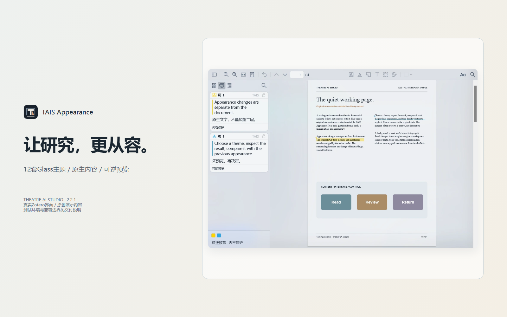

# TAIS Appearance`r`n`r`n`r`n`r`n**让 Zotero 拥有更安静、清晰、统一的阅读工作空间。**`r`n`r`n[交互式产品展示](https://lipo1024.github.io/tais-appearance/) · [GitHub 源码](https://github.com/LIPO1024/tais-appearance)`r`n

由 Theatre AI Studio（TAIS）开发的 Zotero Glass 外观与阅读环境扩展。

提供12套Glass模板、浅深模式、界面与批注独立排版、阅读纸底、外围透明、本地背景、可撤销预览、个人方案、诊断与安全模式。

语言：简体中文、英语、日语、韩语、法语，以及跟随 Zotero 自动选择。翻译覆盖率与人工校对状态见 docs/I18N-STATUS.md。

兼容性：当前实测 Windows 11、Zotero 10.0.8、PDF.js 5.7.0。当前原生材质适配依赖 Windows DWM，macOS/Linux 尚不支持。

安装：从 GitHub Releases 下载XPI，在 Zotero → 工具 → 插件 → 齿轮 → 从文件安装插件中选择。异常时可在设置中恢复 Zotero 原生外观。

隐私：背景图片仅本地处理。插件不需要 Zotero 云凭据，不主动读取或上传文献正文。PDF绘制仍由 Zotero/PDF.js 管理。

许可：衍生代码遵循适用的 AGPL 条款，详见 LICENSE、NOTICE 与 docs/THIRD_PARTY_NOTICES.md。资助仅支持维护，不锁定AGPL覆盖的主题功能；12套内置主题对所有用户开放。

## User guides / 使用手册
- [简体中文](docs/USER_GUIDE.zh-CN.md)
- [English](docs/USER_GUIDE.en-US.md)
- [日本語](docs/USER_GUIDE.ja-JP.md)
- [한국어](docs/USER_GUIDE.ko-KR.md)
- [Français](docs/USER_GUIDE.fr-FR.md)

Product tour / 产品展示: https://lipo1024.github.io/tais-appearance/

